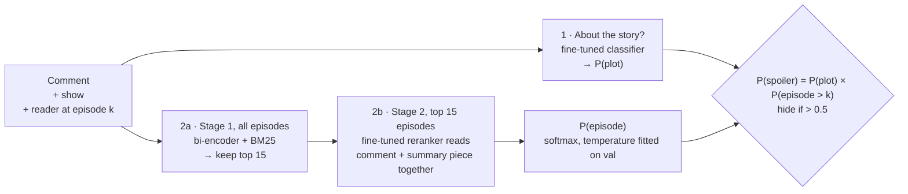
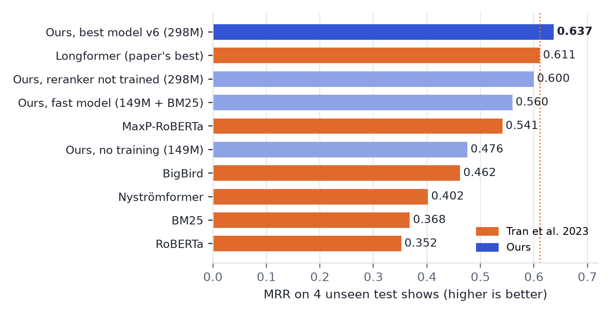
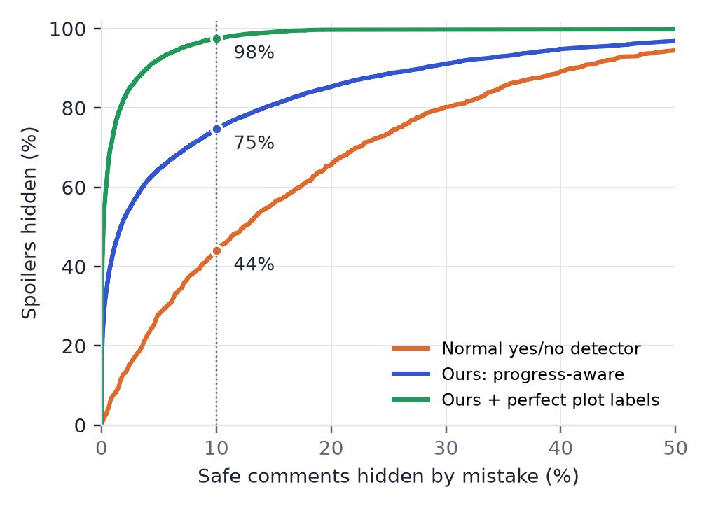
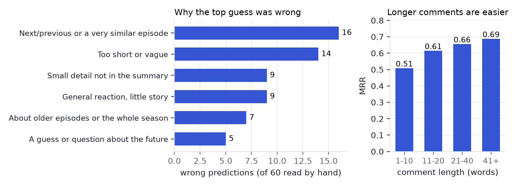

# Progress-Aware Spoiler Filter

**Hide a TV-show comment only from people who haven't watched the episode it spoils.**

Normal spoiler detectors answer one question for everyone: *spoiler or not?* But a comment about episode 8 is fine
for someone who has watched 10 episodes and a spoiler for someone at episode 3. This project builds a filter that
knows where the reader is in the show.

- **Episode matcher (v6):** finds which episode a comment talks about. On the public spoiler-matching benchmark
  (Tran et al., EMNLP 2023) it reaches **MRR 0.637** on 4 unseen test shows. The best published model reaches **0.611**.
  It has 298M parameters and runs on a 6 GB laptop GPU.
- **Full progress-aware filter:** hides **75%** of spoilers when 10% of safe comments are hidden. A normal yes/no
  spoiler detector hides **44%** at the same rate. The 2023 paper left this filter as future work.

**[▶ Try the interactive demo](https://ahmeddatori.github.io/progress-aware-spoiler-filter/)** (200 real test comments with the
model's real outputs: pick a show, set your episode, see what gets hidden) · [Slides (PDF)](docs/slides.pdf) ·
[Method](docs/METHOD.md) · [All experiments](docs/EXPERIMENTS.md) · [Reproduce](docs/REPRODUCE.md)

---

## How it works



| Step | What it does | Model |
|---|---|---|
| 1. About the story? | "This episode was fun" is never a spoiler. A text classifier gives P(plot). | ModernBERT embed, fine-tuned (149M) |
| 2a. Stage 1 | Compares the comment with every 200-word piece of every episode summary (vectors + BM25 word match). Keeps the 15 best episodes. | `nomic-ai/modernbert-embed-base`, fine-tuned (149M) |
| 2b. Stage 2 | Reads the comment and each of the 4 best pieces per kept episode *together*, so it catches details. | `Alibaba-NLP/gte-reranker-modernbert-base`, fine-tuned (149M) |
| 3. Decide | P(spoiler) = P(plot) × P(comment is about an episode after yours). | – |

Details: [docs/METHOD.md](docs/METHOD.md).

## Results

All numbers are on the test set: 3,105 hand-labelled comments from 4 shows that are **never seen in training**.

### Episode matching

| Model | Parameters | MRR | Top-1 | Time for all test comments* |
|---|---|---|---|---|
| BM25 word matching (paper / ours) | – | 0.368 / 0.363 | 0.21 | – |
| MaxP-RoBERTa (paper) | 125M | 0.541 | – | – |
| **Longformer (paper's best)** | 149M | **0.611** | – | about 15 h (estimate) |
| Ours, fast model (bi-encoder + BM25) | 149M | 0.560 | 0.41 | 12 s |
| Ours, v6 light setting (5 episodes, 1 piece) | 298M | 0.591 | – | 2 min |
| **Ours, v6 (mean of 3 training runs)** | 298M | **0.637 ± 0.002** | **0.51** | 21 min |

\*One laptop GPU (RTX 4050, 6 GB). The Longformer time is an estimate from timing single pairs, so the speed-up is rough.

<p align="center"></p>

### The full filter

We simulate a reader at every episode of every test show and ask the filter about every test comment
(206,968 reader–comment pairs, 44% of them spoilers). All systems are compared when they wrongly hide the same 10% of safe comments.

| System | Spoilers hidden (10% safe hidden) | AUC |
|---|---|---|
| Normal yes/no spoiler detector | 44.0% | 0.826 |
| **Ours, progress-aware** | **74.7%** | **0.914** |
| Ours with perfect "about the story" labels (upper bound) | 97.5% | 0.986 |

The normal detector also hides **74%** of story comments about episodes the reader has *already watched*; ours hides **5%**.

<p align="center"></p>

### Where it still fails

The right episode is first for 51% of comments, in the top 3 for 72% and in the top 5 for 80%. We read 60 wrong predictions by hand.
The most common causes are a neighbouring episode that tells the same story, and comments that are too short to say much
("SHE CALLED HIM TWINKLETOES."). See [docs/EXPERIMENTS.md](docs/EXPERIMENTS.md#error-analysis).

<p align="center"></p>

## Quick start

Requirements: Python 3.12, [uv](https://docs.astral.sh/uv/), an NVIDIA GPU with 6 GB or more (a CPU works for the demo, slowly).

```bash
git clone https://github.com/AhmedDatori/progress-aware-spoiler-filter.git
cd progress-aware-spoiler-filter
uv sync                               # install the exact package versions
bash src/download.sh                  # the dataset (≈60 MB) into data/raw/
bash src/download_models.sh           # our 3 fine-tuned models (≈0.9 GB) into models/

cd src
uv run python demo.py --examples                                       # 4 example comments
uv run python demo.py attack_on_titan 70 "Zeke got shot by Magath"     # your own comment
uv run python demo.py --shows                                          # shows and episode numbers
```

Example output:

```
attack_on_titan, you watched up to episode 70
  comment: "The emotional whiplash Yelena experienced from seeing her God in Zeke light up those Marley
            blimps to watching said God get sniped by Magath and tumble off the Wall"
  about the plot?          100%
  most likely episodes:    ep 85 (27%), ep 77 (23%), ep 68 (22%)
  about a later episode?   74%
  P(spoiler for you)       74%  ->  HIDE
```

To check every number in this README without a GPU, download the saved model scores
(`bash src/download_results.sh`) and run the evaluation scripts. Training every model from scratch is described in
[docs/REPRODUCE.md](docs/REPRODUCE.md).

## Repository layout

```
├── Spoiler_Matching.ipynb   the full story, step by step: data analysis, versions v0–v6, filter, errors (runs on Colab)
├── src/                     all code, one script per step (see src/README.md)
├── results/                 result tables (CSV/JSON), figures, training logs (see results/README.md)
├── docs/                    method, experiments, reproduction guide, slides; docs/index.html = the demo page
├── pyproject.toml, uv.lock  exact dependencies
└── LICENSE
```

## What we learned

1. **Check that validation is honest.** The 4 validation shows also appear in the training data, so validation
   rewarded memorising them: more data helped validation but not test. After we removed them from training, validation
   and test agreed (0.634 vs 0.635).
2. **Fine-tune the reranker.** A ready-made reranker *hurt* (0.512). The same kind of model fine-tuned on this task
   gave the biggest single gain (0.600 → 0.637).
3. **Small and trained beats big and untrained.** Qwen3-Embedding-8B with no training scored 0.557, the same as our
   149M fine-tuned model, at 54× the size.

## Limitations

- The paper reports one number (0.611), so a paired significance test is not possible. All 3 of our runs are above it
  (bootstrap 95% range for one run: 0.624–0.650).
- v6 has 298M parameters, about twice the paper's Longformer-base. Our 149M fast model is much faster but scores lower (0.560).
- One dataset: 4 animated TV shows from Reddit. Live-action shows, movies and books are untested.
- The filter is tested with simulated readers, not real users.
- The weakest part is the "about the story?" classifier (AUC 0.884). With perfect labels the filter would hide 98% of spoilers.

## Data and credits

- Dataset: [bobotran/spoiler-matching](https://huggingface.co/datasets/bobotran/spoiler-matching) (CC BY-SA 3.0), from
  Tran, Xu & McAuley, *Spoiler Detection as Semantic Text Matching*, EMNLP 2023. It is downloaded by `src/download.sh`, not stored here.
- Base models: [nomic-ai/modernbert-embed-base](https://huggingface.co/nomic-ai/modernbert-embed-base) and
  [Alibaba-NLP/gte-reranker-modernbert-base](https://huggingface.co/Alibaba-NLP/gte-reranker-modernbert-base) (Apache 2.0).
- Made by **Ahmed Can** ([@AhmedDatori](https://github.com/AhmedDatori)) and **Hamza Khamach** as the term project of
  CMP4507 Text Mining, Bahçeşehir University, autumn 2026. Developed with the help of an AI coding assistant.

## License

Code: [MIT](LICENSE). The fine-tuned models in the release are trained on CC BY-SA 3.0 data; credit the dataset authors when you use them.
